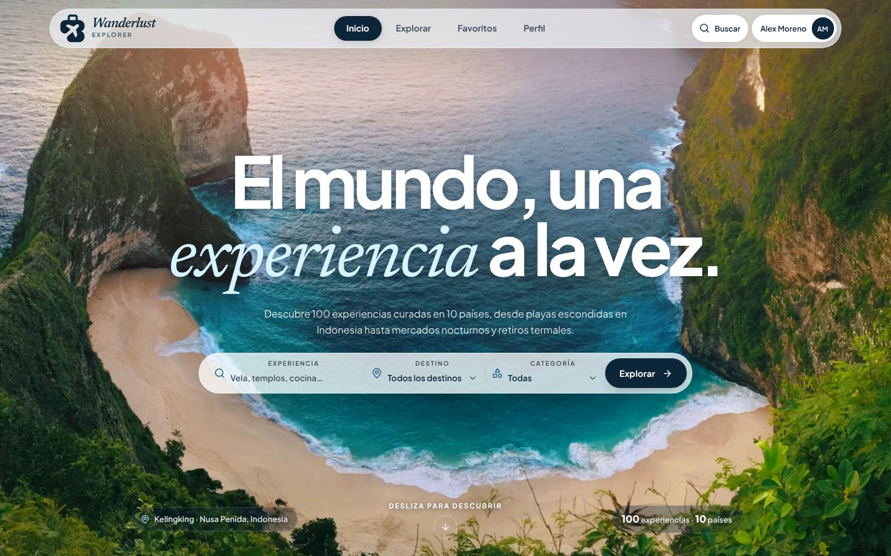
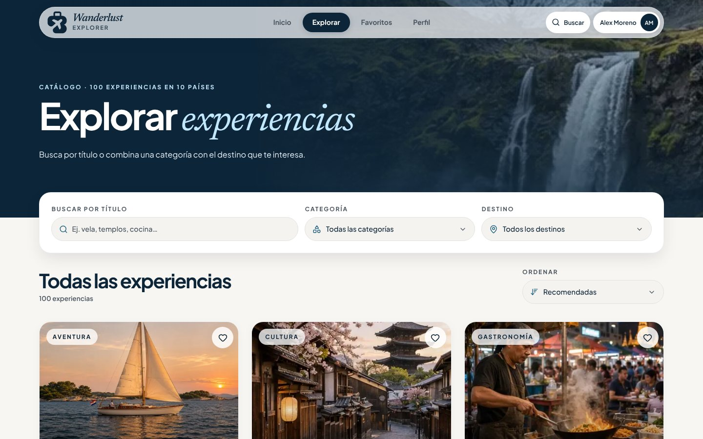
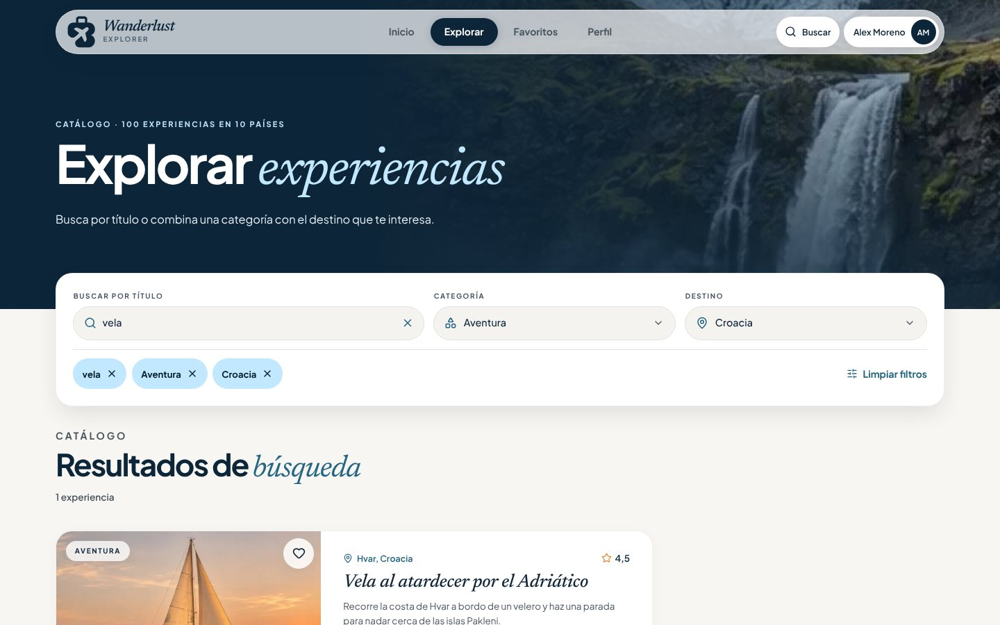
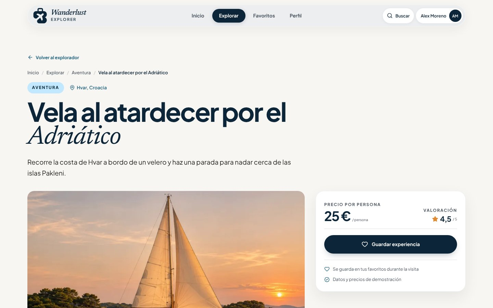
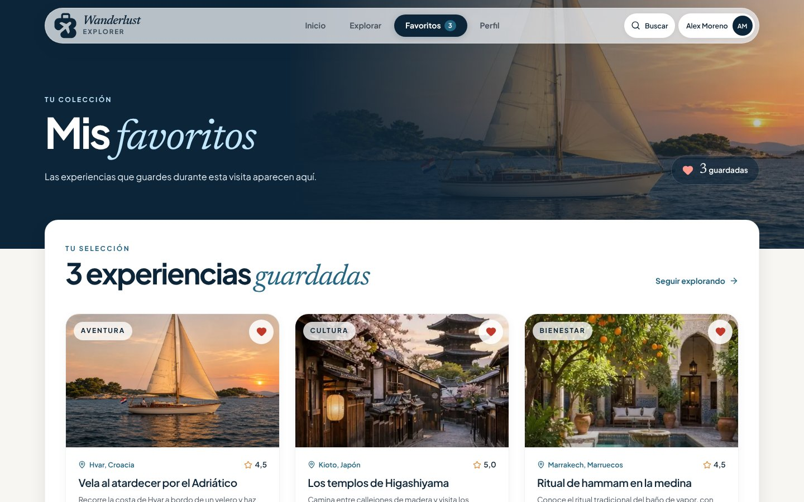
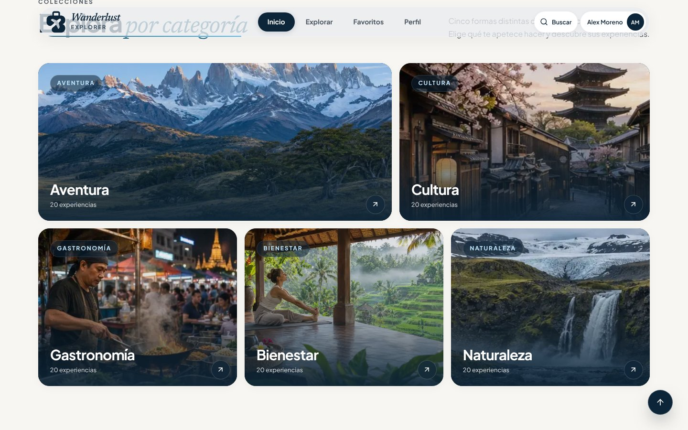
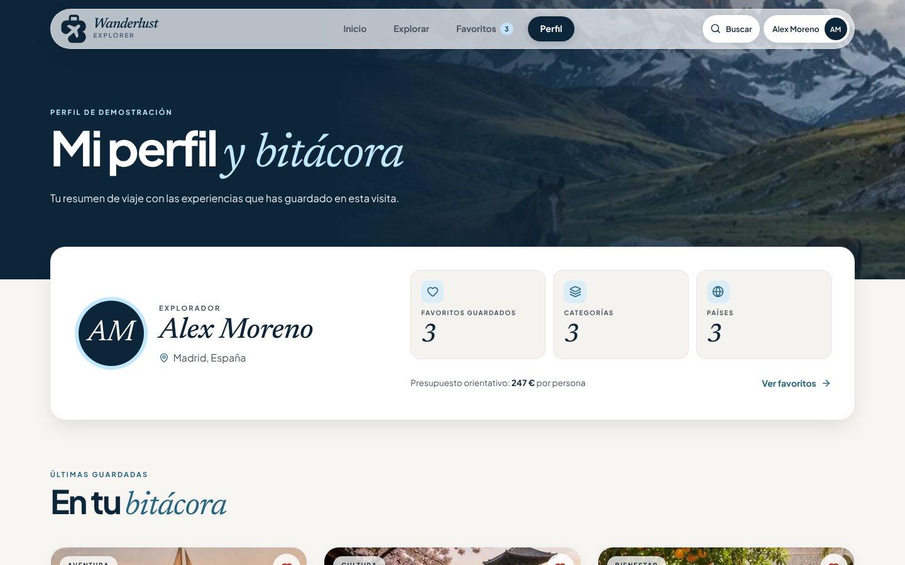
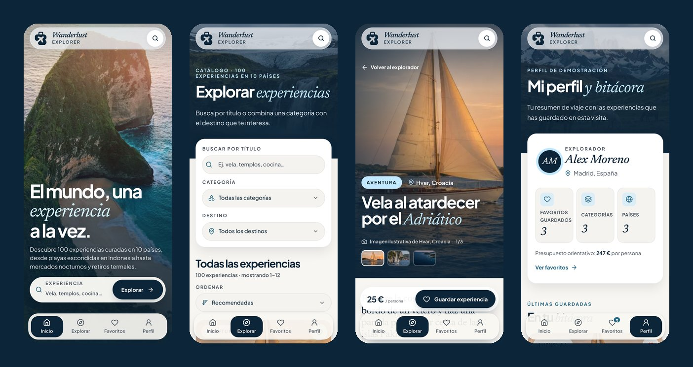

# Wanderlust Explorer

Explorador de experiencias de viaje desarrollado con Next.js (App Router), React, TypeScript y Tailwind CSS para el proyecto **Wanderlust Explorer** de 4Geeks Academy. Permite descubrir 100 experiencias, buscarlas por título, combinar filtros de categoría y destino que se reflejan en la URL, consultar cada ficha y guardar favoritos durante la visita.



## Funcionalidades

- **Cinco páginas** con navegación del lado del cliente: Inicio, Explorar, Detalle, Favoritos y Perfil, además de una página 404 propia.
- **Búsqueda por título** con expresión regular insensible a mayúsculas. Admite términos sin tilde y trata los caracteres especiales como texto.
- **Filtros de categoría y destino** (ciudad o país) combinables con la búsqueda.
- **Estado en la URL**: `search`, `category` y `destination` se sincronizan con `useSearchParams` y `usePathname`. Un enlace prefiltrado restaura los controles y los resultados.
- **Favoritos** gestionados con `useState` en un proveedor compartido y pasados a cada tarjeta mediante props. Se reflejan en Favoritos y en el contador del Perfil.
- **Catálogo completo al entrar**: el Explorador muestra las 100 experiencias en su estado inicial, con orden por precio o valoración y paginación opcional de 12 en 12 (`sort` y `page` en la URL).
- **Experiencia móvil cuidada**: barra de navegación inferior con la sección activa y el contador de favoritos, avisos al guardar o quitar un favorito (con opción de deshacer), barra fija de precio y guardado en la ficha y desplegables propios accesibles con teclado.
- **Diseño responsive** para móvil, tablet y escritorio, con soporte de teclado y de la preferencia de movimiento reducido.

## Capturas

| Explorar | Filtros combinados |
| --- | --- |
|  |  |

| Detalle | Favoritos |
| --- | --- |
|  |  |

| Categorías | Perfil |
| --- | --- |
|  |  |



## Tecnologías

| Área | Herramientas |
| --- | --- |
| Framework | Next.js 16 (App Router), React 19 |
| Lenguaje | TypeScript |
| Estilos | Tailwind CSS 4 y CSS propio con variables de diseño |
| Tipografía | Plus Jakarta Sans y Newsreader |
| Iconos | Lucide |
| Calidad | ESLint (configuración de Next.js) |

## Rutas

| Ruta | Contenido |
| --- | --- |
| `/` | Portada con buscador, categorías, experiencias destacadas y resumen del catálogo |
| `/experiences` | Catálogo con buscador, filtros, chips de filtros activos, orden y paginación opcional |
| `/experiences/[id]` | Ficha con galería, datos de la experiencia, precio, valoración y acción de guardar |
| `/favorites` | Experiencias guardadas durante la visita |
| `/profile` | Perfil de demostración con el total de favoritos, categorías y países guardados |

Ejemplo de enlace prefiltrado: `/experiences?search=vela&category=adventure&destination=Croatia`

## Ejecutar en local

Requiere Node.js 20.9 o superior.

```bash
npm ci
npm run dev
```

La aplicación queda disponible en [http://localhost:3000](http://localhost:3000).

Para comprobar la versión de producción:

```bash
npm run lint
npm run build
npm start
```

## Estructura

```text
src/
├── app/          Rutas, layout, página 404 y estilos globales
├── components/   Navbar, ExperienceCard, SearchBar, FilterBar y resto de componentes
├── hooks/        useExperiences: búsqueda, filtros, orden, paginación y estado en la URL
├── lib/          Etiquetas, formato de precios y opciones de destino
├── data/         Dataset tipado de 100 experiencias
└── types/        Interfaz Experience y categorías
```

## Decisiones técnicas

- **`useExperiences`** concentra el filtrado: lee la URL, normaliza el texto, construye la expresión regular y devuelve los resultados ordenados (y paginados si se elige) junto con las acciones para actualizar los filtros.
- **`SearchBar`** usa `useEffect` para sincronizar el campo con la URL cuando se navega con Atrás y Adelante, sin provocar bucles.
- **Favoritos sin persistencia**: el estado vive en un proveedor del layout y se reinicia al recargar la página, como define el alcance del ejercicio. No se usan `localStorage` ni librerías externas de estado.
- **Desplegables accesibles** propios, con navegación por teclado, en lugar de los selectores nativos del sistema.

## Datos

El archivo `src/data/experiences.ts` contiene 100 experiencias generadas con asistencia de IA: 20 por cada categoría (Aventura, Cultura, Gastronomía, Bienestar y Naturaleza) en 10 países. Los precios, valoraciones y el perfil son ficticios, y las imágenes tienen fines ilustrativos.

## Design References

- [GetYourGuide](https://www.getyourguide.com/): navegación por categorías y catálogo con accesos directos.
- [Viator](https://www.viator.com/): jerarquía de las tarjetas, con destino, valoración y precio fáciles de comparar.

## Autor

Roger Martínez · [github.com/rogerdevmtz](https://github.com/rogerdevmtz)
